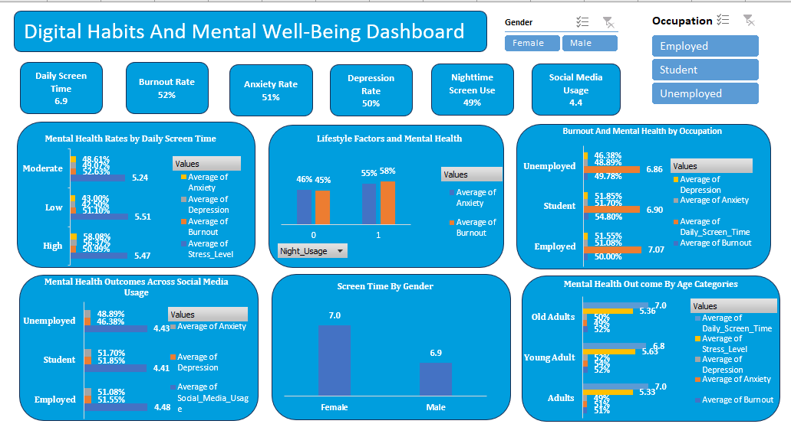

# 📊 Digital Habits & Mental Well-Being Analysis (Excel Dashboard)

## 📌 Executive Summary
This project explores how daily digital habits, specifically total screen time, social media usage, and nighttime device exposure, impact mental well-being, indicators (burnout, anxiety, depression, and stress) across demographic segments. Built entirely in **Microsoft Excel**, this interactive dashboard translates raw survey data into actionable insights for workplace and student wellness initiatives.

---

## 🧹 Data Cleaning, Quality Assurance & Feature Engineering
Before building visualizations, the raw dataset underwent thorough auditing and preparation in Excel to ensure analytical accuracy:
* **Data Quality & Integrity Checks:** Audited the dataset for duplicate records, missing or null values, calculation errors (`#VALUE!`, `#N/A`, `#DIV/0!`), and inconsistent data types or formatting across columns.
* **Age Categories** *(derived from `Age`)*: Engineered a categorical column using conditional formulas (`IF` / `IFS`) to group continuous respondent ages into three life-stage segments (**Young Adult**, **Adults**, and **Old Adults**) for cohort analysis.
* **Daily Screen Time Categories** *(derived from `Daily_Screen_Time`)*: Bucketed daily screen hours into **Low**, **Moderate**, and **High** usage tiers to evaluate how escalating screen exposure correlates with anxiety, depression, burnout, and stress.

---

## 🎯 Key Questions & Findings

* **Does higher screen time worsen mental health?**  
  **Yes.** Heavy daily screen users report significantly higher rates of **anxiety (58.08%)** and **depression (56.37%)** compared to low screen users (**43.00%** anxiety and **42.50%** depression) a 14–15 percentage point jump, while overall stress and burnout remain relatively steady across tiers.
 * **Business Recommendation:**
Management should consider:
* Monitoring employees with consistently high screen exposure.
* Encouraging regular breaks from digital devices.
* Promoting healthier screen-time habits.
* Reviewing whether employees can reduce unnecessary screen exposure during working hours
  
* **Which occupation is most affected?**  
  **Students** experience the highest overall strain leading in **burnout (54.80%)**, **depression (51.85%)**, and **anxiety (51.70%)**. Meanwhile, **Employed** individuals log the highest daily screen time (**7.07 hrs** vs. the 6.9-hour overall average) alongside elevated depression (**51.55%**) and anxiety (**51.08%**).
 * **Business Recommendation:**  
Management should pay particular attention to students and consider initiatives such as:
* Stress-management programmes.
* Mental health awareness sessions.
* Workload and study-pressure management.
* Access to counselling and support services.
  
* **Does daily screen time vary significantly between male and female respondents?**  
  Average daily screen time remains virtually uniform across genders 7.0 hours for females and 6.9 hours for males confirming that excessive screen usage affects both groups equally
* **Business Recommendations:**
* Encourage both male and female individuals to maintain healthy daily screen-time habits.
* Promote regular breaks from digital devices to reduce excessive screen exposure.
* Encourage healthier digital habits, including limiting unnecessary screen usage before bedtime.
* Monitor screen time alongside mental health indicators to identify potential well-being concerns.
  
* **What lifestyle factors support better mental well-being?**  
  **Avoiding nighttime screen use** and **limiting total daily screen time** show the strongest protective effects. Non-nighttime screen users report notably lower **burnout (45% vs. 58%)** and **anxiety (46% vs. 55%)** than nighttime users.
 * **Business recommendations:**
* Management should consider:
* Encouraging employees to disconnect from digital devices before bedtime.
* Promoting healthy digital boundaries outside working hours.
* Avoiding unnecessary after-hours work communications.
* Raising awareness of the importance of digital rest.
---

## 📈 Baseline KPIs
| Metric | Overall Average / Rate |
| :--- | :---: |
| **Daily Screen Time** | 6.9 hrs |
| **Social Media Usage** | 4.4 hrs |
| **Nighttime Screen Use** | 49% |
| **Burnout Rate** | 52% |
| **Anxiety Rate** | 51% |
| **Depression Rate** | 50% |

---

---

## 🛠️ Excel Tools & Techniques Used
* **Data Cleaning & Auditing:** Duplicate detection, missing value checks, error validation, and data type standardization.
* **Feature Engineering & Formulas:** Conditional logic (`IF` / `IFS`) to bin raw numerical columns into `Age Categories` and `Daily Screen Time Categories`.
* **Data Aggregation:** PivotTables and custom calculated fields to summarize mental health rates across screen-time tiers, age groups, and occupations.
* **Data Visualization:** Multi-panel PivotCharts (clustered bar and column charts) paired with custom KPI cards for executive-level readability.
* **Interactive Filtering:** Dynamic Excel Slicers (`Gender`, `Occupation`) enabling real-time demographic drill-downs.
